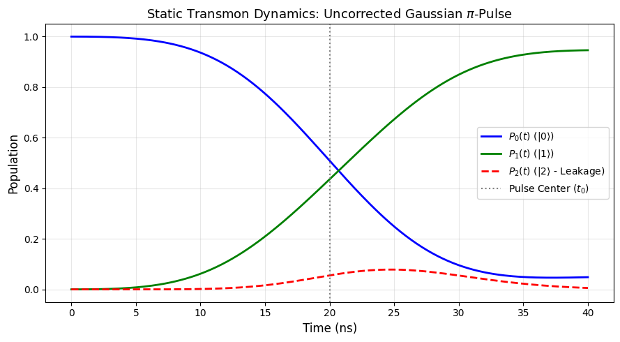
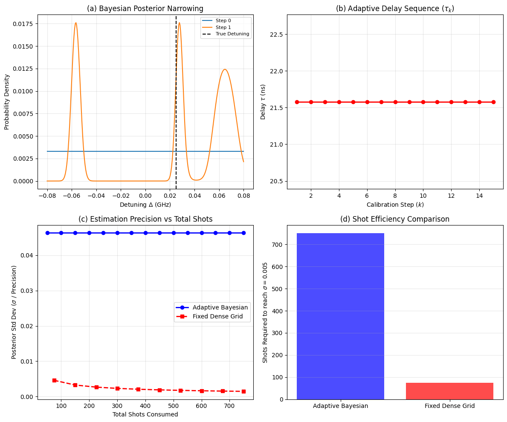
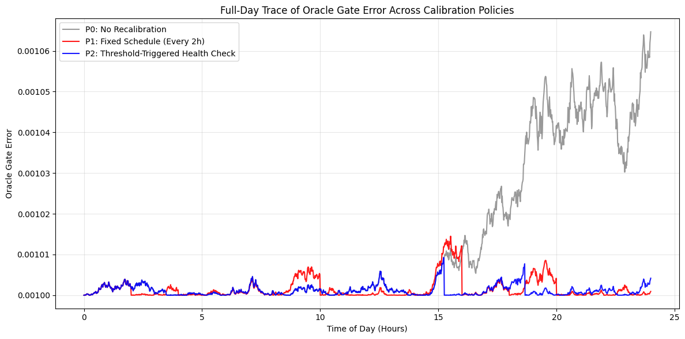

<h1 align="center">Three-Level Transmon</h1>
<p align="center">
  <b>Pulse simulation, qubit calibration and drift management for a driven three-level transmon</b>
</p>

<p align="center">
  
  
  
  
</p>

<p align="center">
  
</p>

---

## Table of Contents

1. [About the Project](#about-the-project)
2. [Getting Started](#getting-started)
3. [Project Structure](#project-structure)
4. [Methodology](#methodology)
5. [Results](#results)
6. [Notes on the Results](#notes-on-the-results)
7. [License](#license)

---

## About the Project

A transmon qubit is never perfectly a two-level system: the third level $|2\rangle$ causes **leakage**, and the qubit frequency drifts during the day. This project simulates a driven **three-level transmon** in QuTiP and works through four stages:

| # | Stage | Question |
|---|---|---|
| 1 | Static π-pulse | How much error and leakage does a 40 ns Gaussian pulse with DRAG have? |
| 2 | Calibration scans | Can amplitude, frequency and DRAG be scanned from noisy shot data? |
| 3 | Adaptive Bayesian Ramsey | Can a hidden detuning be estimated with a grid posterior and adaptive delays? |
| 4 | 24-hour drift | When should the qubit be recalibrated: never, on a schedule, or on a health check? |

Everything is in one notebook, `3_level_transmon.ipynb`.

## Getting Started

### Prerequisites

- Python 3.9 or newer
- `numpy`, `scipy`, `matplotlib`, `qutip`, `jupyter`

### Installation and usage

```bash
git clone https://github.com/shreyamittal0622/three-level-transmon-calibration.git
cd three-level-transmon-calibration
pip install numpy scipy matplotlib qutip jupyter
jupyter notebook notebooks/3_level_transmon_original.ipynb
```

Run all cells top to bottom. Random seeds are fixed in the notebook (seed 42), so the printed numbers and figures below are reproducible.

## Project Structure

```
.
├── README.md
├── LICENSE
├── notebooks/
│   └── 3_level_transmon_original.ipynb    full simulation, calibration and drift study
├── docs/
│   └── original_report.pdf                written report of the notebook
└── results/
    └── original_notebook/                 figures and printed numbers from the notebook
```

## Methodology

**Units.** Time in ns; α = −0.210, t_g = 40 ns, σ = t_g/4 = 10 ns, t₀ = 20 ns, θ = π. Energies are used directly as angular frequencies in the Hamiltonian.

### 1. Driven transmon

$$H(t)=\Delta(t)\,a^\dagger a+\frac{\alpha}{2}\,a^\dagger a^\dagger a a+\frac{g(t)}{2}\Big[\Omega_x(t)(a+a^\dagger)+\Omega_y(t)\,i(a^\dagger-a)\Big]\qquad(1)$$

Δ(t) is the drifting detuning, α the anharmonicity (it shifts |2⟩ so that 0↔1 can be driven without 1↔2), g(t) the drive gain, and Ω_x, Ω_y the drive quadratures. In the qubit subspace a+a† → σₓ and i(a†−a) → σ_y.

### 2. Gaussian pulse and DRAG

$$\Omega_x(t)=A\,e^{-(t-t_0)^2/2\sigma^2},\qquad \int\Omega_x\,dt=\theta\ \Rightarrow\ A=\frac{\theta}{\sigma\sqrt{2\pi}}\qquad(2a)$$

$$\Omega_y(t)=-\beta\,\dot\Omega_x(t)\qquad(2b)$$

For θ = π, A ≈ 0.1253. The derivative quadrature suppresses the 1↔2 transition. First-order theory gives |β| ≈ 1/|α| ≈ 4.76, used as the initial guess in the notebook.

### 3. Gate error including leakage

$$\bar F=\frac{\mathrm{Tr}(M_VM_V^\dagger)+|\mathrm{Tr}\,M_V|^2}{d(d+1)},\quad M_V=V^\dagger M,\ M=PUP,\ d=2,\qquad \epsilon=1-\bar F\qquad(3a)$$

M is the 2×2 qubit block of the 3×3 propagator, so leakage counts as error automatically. State-based version used in the notebook (|0⟩ → |1⟩):

$$F=|\langle 1|\psi(t_g)\rangle|^2=P_1(t_g),\quad \epsilon=1-P_1(t_g),\quad \text{leakage}=P_2(t_g),\quad P_0+P_1+P_2=1\qquad(3b)$$

### 4. Amplitude calibration (error amplification)

$$\langle Z\rangle=-(-1)^n\sin(n\pi\eta)\qquad(4)$$

Each nominal π pulse over-rotates by η; the signal is linear in η and amplified n-fold.

### 5. Ramsey frequency measurement

$$P(0\mid\Delta,\tau)=\tfrac12\Big[1+e^{-\tau/T_2}\cos(2\pi\Delta\tau+\varphi_0)\Big]\qquad(5)$$

A single delay is unambiguous only for |Δ| < 1/(2τ₀) (aliasing); a ladder τ_k = 2^k τ₀ resolves precision and ambiguity. The notebook simulates the full 3-level sequence with two 20 ns Gaussian π/2 pulses and reads out P(|1⟩).

### 6. Cramér–Rao bound

$$\mathrm{Var}(\hat\Delta)\ \ge\ \frac{1}{(2\pi\tau V)^2\,N},\qquad V=e^{-\tau/T_2}\qquad(6)$$

Variance falls as 1/τ² but visibility V shrinks with τ, so the optimum is near τ ≈ T₂.

### 7. DRAG signature

Leakage is invisible to a binary readout, so indirect signatures such as the apparent P(1) after trains of identity pairs [X_π X_{−π}]ⁿ are used. The notebook scans P₂ directly.

### 8. Bayesian update

$$P(\Delta\mid\text{data})\ \propto\ P(\Delta)\binom{N}{k}\,p(\Delta,\tau_k)^k\,[1-p(\Delta,\tau_k)]^{N-k},\qquad \sum_i P(\Delta_i\mid\text{data})=1\qquad(8)$$

301-point grid on [−0.08, 0.08], uniform prior, N = 50 shots per step. p(Δ, τ) is the simulated P(|1⟩) of the Ramsey sequence for trial detuning Δ, which provides the likelihood.

### 9. Posterior moments and next-delay rule

$$\bar\Delta=\sum_i\Delta_iP(\Delta_i),\quad \sigma_\Delta=\sqrt{\sum_iP(\Delta_i)(\Delta_i-\bar\Delta)^2},\quad \tau_{\rm next}=\mathrm{clip}\!\left(\frac{1}{\sigma_\Delta},\,5\text{ ns},\,200\text{ ns}\right)\qquad(9)$$

### 10. Measurement model

$$k\sim\mathrm{Binomial}(S,p),\qquad \hat p=\frac{k}{S},\qquad \sigma_{\hat p}=\sqrt{\frac{\hat p(1-\hat p)}{S}}\qquad(10)$$

### 11. Drift model

$$\Delta(t_m)=\Delta(0)+\sum_{j=1}^{m}\xi_j,\qquad \xi_j\sim\mathcal N(0,\sigma_\xi^2),\quad m=0,\dots,1439\qquad(11)$$

Random walk, one step per minute; Δ(0) = 0.02, σ_ξ = 0.0002 per minute, seed 42.

### 12. Oracle gate error

$$\epsilon(t)=\epsilon_0+\tfrac12\big(\Delta(t)-\Delta_{\rm cal}\big)^2,\qquad \epsilon_0=10^{-3}\qquad(12)$$

### 13. Recalibration policies

| Policy | Rule |
|---|---|
| **P0** | Calibrate once at t = 0, never again |
| **P1** | Recalibrate every 120 min |
| **P2** | Health check every 5 min; recalibrate if the shift exceeds 0.004 |

Costs defined for the study: 2 min per full calibration, 0.2 min per health check.

## Results

All results below are the outputs of `notebooks/3_level_transmon_original.ipynb`.

### 1. Static π-pulse

Setup: A = 0.1253, initial DRAG β = 1/|α| = 4.762, 200 time points over the pulse.

| P₀(t_g) | P₁(t_g) (target) | P₂(t_g) (leakage) | Gate error ε = 1 − P₁ |
|---|---|---|---|
| 0.04829 | 0.94617 | 0.00554 | 0.05383 |

<p align="center">
  <br>
  <em>Population dynamics of the Gaussian π-pulse. P₀ falls and P₁ rises, crossing near the pulse centre at 20 ns; leakage P₂ peaks at ≈ 0.08 near 25 ns and then falls back.</em>
</p>

The pulse transfers about 94.6 % of the population into |1⟩. Most of the 5.4 % error is population left in |0⟩ (4.8 %), with 0.55 % remaining in |2⟩. Leakage peaks mid-pulse and mostly returns, so |2⟩ acts as a transient intermediate level.

### 2. Calibration scans

Three one-dimensional scans, each with 400 simulated shots per point (seed 42).

| Routine | Scan | Selection rule | Result | Uncertainty | Shots |
|---|---|---|---|---|---|
| (a) π-amplitude | 11 scale factors, 0.8–1.2 × A | maximise P₁ | A = 0.1504 | 0.0200 | 4,400 |
| (b) Frequency | 11 detunings, −0.1 to 0.1 | minimise P₁ | Δ = −0.1000 | 0.0100 | 4,400 |
| (c) DRAG β | 13 values, 0 to 3 | minimise P₂ | β = 1.75 | 0.0500 | 5,200 |

### 3. Adaptive Bayesian Ramsey frequency calibration

Setup: true detuning 0.025, 301-point grid on [−0.08, 0.08], uniform prior, 15 steps × 50 shots = 750 shots, delay from Eq. (9). A fixed-delay baseline (10 delays from 10 to 200 ns, same shot budget) is used for comparison.

| Quantity | Value |
|---|---|
| True detuning | 0.025 |
| Final MAP estimate | **0.0277** |
| Shot saving printed by the notebook | −900 % |

<p align="center">
  <br>
  <em>(a) posterior narrowing, (b) adaptive delay sequence, (c) estimation precision vs total shots, (d) shot-efficiency comparison.</em>
</p>

- **(a)** After the first update the flat prior (height ≈ 0.0033 = 1/301) becomes three peaks near −0.056, +0.027 and +0.065. The tallest, narrow peak lies close to the true detuning; the other two show that one Ramsey delay cannot identify the detuning uniquely.
- **(b)** The delay is 21.58 ns at every step, equal to 1/0.0463, the standard deviation of the prior.
- **(c)** The adaptive curve sits at σ ≈ 0.0463 for every shot count. The fixed-grid curve falls from about 0.0046 to 0.0015.
- **(d)** The adaptive routine uses its full 750 shots (target σ = 0.005 not reached) against 75 for the fixed grid.

### 4. 24-hour drift and recalibration policies

Setup: random-walk drift from Δ(0) = 0.02 with 0.0002 steps per minute over 1,440 minutes (seed 42); oracle error ε = 0.001 + ½(Δ − Δ_cal)².

| Policy | Rule | Recalibrations |
|---|---|---|
| P0 | Calibrate once at t = 0 | 0 |
| P1 | Every 120 min | 12 (as counted by the code) |
| P2 | Health check every 5 min, threshold 0.004 | 2 |

<p align="center">
  <br>
  <em>Full-day oracle gate error for P0 (grey), P1 (red) and P2 (blue).</em>
</p>

- **P0** stays on the 0.0010 floor for the first ~15 hours, then climbs steadily to about 0.00106 by the end of the day.
- **P1** shows sawtooth-like bumps that reset to the floor at each scheduled recalibration, with a peak near 0.00114 around 15.5 hours just before a reset.
- **P2** tracks the same excursions but resets only when the threshold is crossed (near 15 h and 19 h), keeping the error low for the rest of the day with two recalibrations.

The absolute differences are small (all within about 6 × 10⁻⁵ of the floor) because the quadratic penalty and the drift rate are both small. Both active policies prevent the late-day growth seen in P0, and P2 does so with far fewer calibrations than P1.

## Notes on the Results

These come from the study's own report (`docs/original_report.pdf`) and should be kept in mind when quoting the numbers:

- The **static π-pulse** results and the **qualitative ordering of the drift policies** are physically meaningful.
- The **calibration scan** values were obtained with the base Hamiltonian passed to the solver at every scan point, and the uncertainties are fixed constants, so these three numbers should not be read as calibrated parameters.
- The **Bayesian** update sits outside the 15-step loop, so only one posterior update occurs; the delay and the posterior width stay constant. The fixed-grid curve uses an assumed 0.04/√N law, so the −900 % shot saving and panel (d) do not measure real relative efficiency.
- The **drift** comparison assumes perfect, instantaneous recalibration and a noise-free health check, and the stated calibration costs (2 min, 0.2 min) were not applied. The P1 count of 12 comes from `1440 // 120`; resets actually occur at 120 … 1320 min, i.e. 11 times.

## License

Distributed under the MIT License. See [`LICENSE`](LICENSE).
